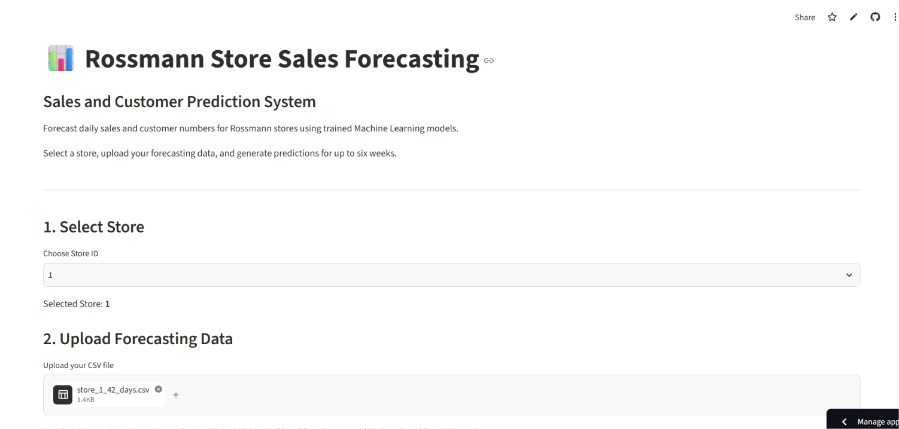
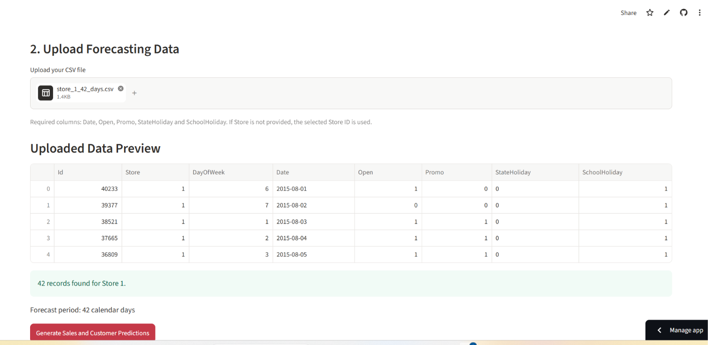
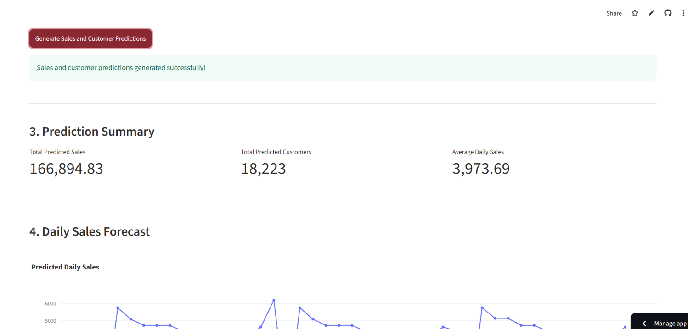
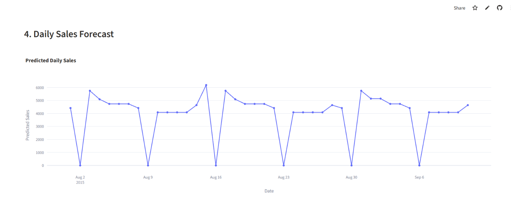
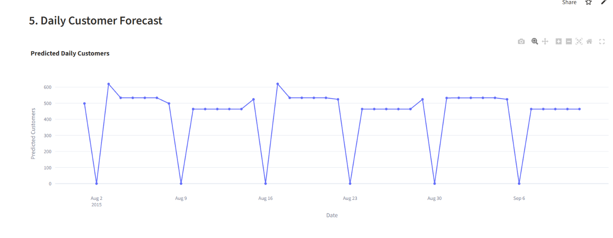
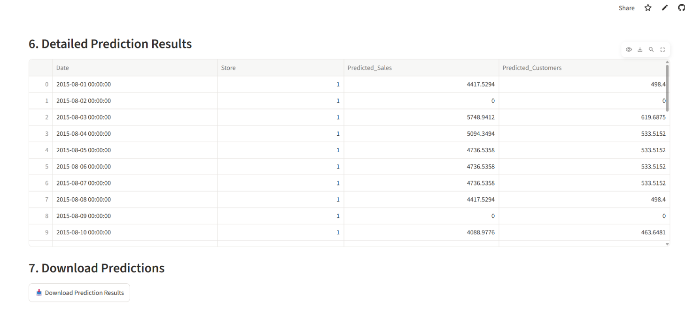

# 🏬 Rossmann Store Sales Forecasting

### Six-Week Sales and Customer Forecasting Using Machine Learning and Deep Learning

[](https://www.python.org/)
[](https://streamlit.io/)
[](https://scikit-learn.org/)
[](https://mlflow.org/)
[](https://dvc.org/)

## 🚀 Live Application

**Explore the deployed Rossmann Sales Forecasting Dashboard:**

👉 [Open Live Streamlit Dashboard](https://rossmann-sales-forecasting-project.streamlit.app/)

The application allows users to select a store, upload input data, generate sales and customer predictions for up to 42 days, visualize forecasting results, and download prediction reports.

---

## 📌 Project Overview

Rossmann is one of Europe's leading drugstore chains, operating numerous stores across different locations.

Accurate sales forecasting is important for retail businesses because it helps with inventory management, staffing, budgeting, and business planning.

The objective of this project is to develop a forecasting solution that predicts daily sales and customer numbers for Rossmann stores up to six weeks in advance using historical sales data, store information, promotions, and calendar-related features.

The project explores both traditional machine learning techniques and deep learning approaches, with a deployed web application for generating predictions.

## 🎯 Project Objectives

- Perform exploratory data analysis to understand sales patterns and customer purchasing behavior.
- Clean and preprocess the datasets.
- Identify important features influencing sales and customer numbers.
- Build and evaluate machine learning regression models.
- Develop a two-layer LSTM model for time-series forecasting.
- Track experiments and manage models using MLflow.
- Track dataset versions using DVC.
- Deploy an interactive forecasting application using Streamlit.

## 📊 Dataset Description

The project uses three primary datasets:

| Dataset | Description |
|---|---|
| `train.csv` | Historical sales, customer, promotion, and store activity information |
| `test.csv` | Records for which sales predictions are required |
| `store.csv` | Store-related information such as store type, assortment, and competition details |

The datasets are merged and processed to create features suitable for machine learning and time-series forecasting.

## 🛠️ Technologies Used

| Category | Tools and Libraries |
|---|---|
| Programming | Python |
| Data Analysis | Pandas, NumPy |
| Visualization | Matplotlib, Seaborn, Plotly |
| Machine Learning | Scikit-learn |
| Deep Learning | TensorFlow, Keras, LSTM |
| Experiment Tracking | MLflow |
| Data Version Control | DVC |
| Web Application | Streamlit |
| Model Storage | Joblib, Keras |

## 🔄 Project Workflow

1. **Data Understanding:** Load and explore the training, testing, and store datasets.
2. **Data Cleaning:** Handle missing values, duplicates, and data inconsistencies.
3. **Exploratory Data Analysis:** Analyze sales distribution, customer behavior, promotions, store characteristics, and time-based trends.
4. **Feature Engineering:** Create useful calendar, promotion, holiday, and store-related features.
5. **Machine Learning:** Train regression models for sales and customer prediction.
6. **Deep Learning:** Develop a two-layer LSTM model for time-series forecasting.
7. **Model Evaluation:** Evaluate predictions using regression performance metrics.
8. **Experiment Tracking:** Log experiments and register models using MLflow.
9. **Data Versioning:** Track original and processed datasets using DVC.
10. **Deployment:** Build and deploy the interactive Streamlit forecasting dashboard.

## 📈 Exploratory Data Analysis

The EDA focuses on understanding the factors that influence retail sales and customer purchasing behavior.

Key analysis areas include:

- Overall sales and customer distribution.
- Sales trends over time.
- Store-wise sales performance.
- Impact of promotions on sales.
- Store type and assortment analysis.
- Holiday and seasonal patterns.
- Relationships between sales, customers, and other features.

**Overall sales statistics:**

| Metric | Value |
|---|---:|
| Total Sales | 5,873,180,623 |
| Average Sales | 5,773.82 |
| Maximum Sales | 41,551 |
| Minimum Sales | 0 |

## 🤖 Machine Learning Models

Machine learning regression models were developed to predict:

- Daily store sales.
- Daily customer counts.

The final registered Decision Tree models achieved the following validation results:

| Prediction Target | Model | MAE | R² Score |
|---|---|---:|---:|
| Sales | Decision Tree Regressor | 971.099 | 0.815 |
| Customers | Decision Tree Regressor | 93.100 | 0.818 |

**Validation details:** The final registered-model evaluation used 47,945 records from 19 June 2015 to 31 July 2015.

MAE measures the average absolute prediction error, while R² indicates how much variation in the target variable is explained by the model.

## 🧠 Deep Learning: LSTM Forecasting

A two-layer Long Short-Term Memory (LSTM) network was developed to capture sequential patterns in historical retail data.

The time-series modelling workflow includes:

- Stationarity analysis using the Augmented Dickey-Fuller (ADF) test.
- Differencing where required.
- ACF and PACF analysis.
- Conversion of time-series data into supervised sliding-window sequences.
- Feature and target scaling to the range (-1, 1).
- Training a two-layer LSTM architecture.
- Saving the trained model and preprocessing scalers.

The trained LSTM model and its associated configuration and scaler files are stored in the `models/` directory.

## 📊 MLflow Experiment Tracking

MLflow was used to track machine learning and deep learning experiments.

The project includes:

- Sales prediction experiments.
- Customer prediction experiments.
- LSTM forecasting experiments.
- Logged model parameters and evaluation metrics.
- Registered sales and customer prediction models.

Registered models:

- `Rossmann_Sales_Model`
- `Rossmann_Customers_Model`

## 🗂️ DVC – Data Version Control

DVC was used to track dataset versions and maintain reproducibility.

The tracked datasets include:

- Original training dataset.
- Original testing dataset.
- Store metadata.
- Processed training dataset.
- Processed testing dataset.

DVC metadata and version history are included in the GitHub repository. The DVC remote storage is not configured; the data cache is maintained locally.


## 📸 Streamlit Dashboard Screenshots

### 1. Dashboard Interface

<p align="center">
  
</p>

### 2. Dashboard Overview

<p align="center">
  
</p>

### 3. Prediction Summary

<p align="center">
  
</p>

### 4. Daily Sales Forecast

<p align="center">
  
</p>

### 5. Daily Customer Forecast

<p align="center">
  
</p>

### 6. Prediction Results

<p align="center">
  
</p>

**Live Application:** [Open Rossmann Sales Forecasting Dashboard](https://rossmann-sales-forecasting-project.streamlit.app/)

## 📁 Project Structure

```text
Rossmann_Sales_Forecasting/
│
├── app/
│   ├── app.py
│   ├── prediction.py
│   ├── preprocessing.py
│   └── requirements.txt
│
├── Data/
│   ├── train.csv
│   ├── test.csv
│   └── store.csv
│
├── models/
│   ├── sales_model.joblib
│   ├── customers_model.joblib
│   ├── rossmann_lstm_multivariate.keras
│   ├── rossmann_lstm_X_scaler.pkl
│   ├── rossmann_lstm_y_scaler.pkl
│   └── rossmann_lstm_multivariate_config.json
│
├── Notebooks/
│   └── Project notebooks
│
├── outputs/
│   ├── MLFlow_Screenshots/
│   ├── Streamlit_Screenshots/
│   └── Processed datasets and outputs
│
├── processed/
├── logs/
├── mlruns/
├── mlflow.db
├── .dvc/
├── README.md
└── LICENSE
```

## ⚙️ Installation and Execution

### 1. Clone the repository

```bash
git clone https://github.com/ijishajain780-ctrl/Rossmann_Sales_Forecasting.git
```

### 2. Navigate to the project directory

```bash
cd Rossmann_Sales_Forecasting
```

### 3. Create and activate a virtual environment

```bash
python -m venv venv
```

Windows:

```bash
venv\Scripts\activate
```

### 4. Install dependencies

```bash
pip install -r app/requirements.txt
```

### 5. Run the Streamlit application

```bash
streamlit run app/app.py
```

Open the local URL displayed in your terminal to access the dashboard.

## 💡 Key Outcomes

- Developed machine learning models for sales and customer forecasting.
- Implemented an LSTM-based time-series forecasting approach.
- Used MLflow for experiment tracking and model registration.
- Applied DVC for dataset version tracking.
- Built and deployed an interactive Streamlit application.
- Enabled users to generate, visualize, and download store-level forecasts.

## 🏁 Conclusion

This project demonstrates an end-to-end retail forecasting workflow, combining data analysis, feature engineering, machine learning, deep learning, experiment tracking, data version control, and web application deployment.

The deployed dashboard provides an interactive way to generate six-week sales and customer forecasts, demonstrating how predictive analytics can support retail planning and decision-making.

---

**Project Repository:** [GitHub – Rossmann Sales Forecasting](https://github.com/ijishajain780-ctrl/Rossmann_Sales_Forecasting)

**Live Dashboard:** [Rossmann Sales Forecasting Application](https://rossmann-sales-forecasting-project.streamlit.app/)
